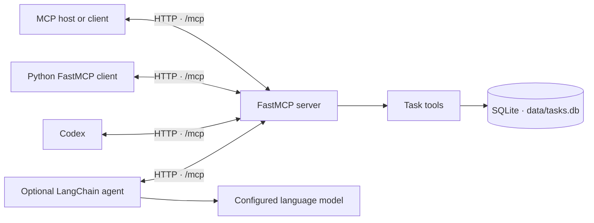
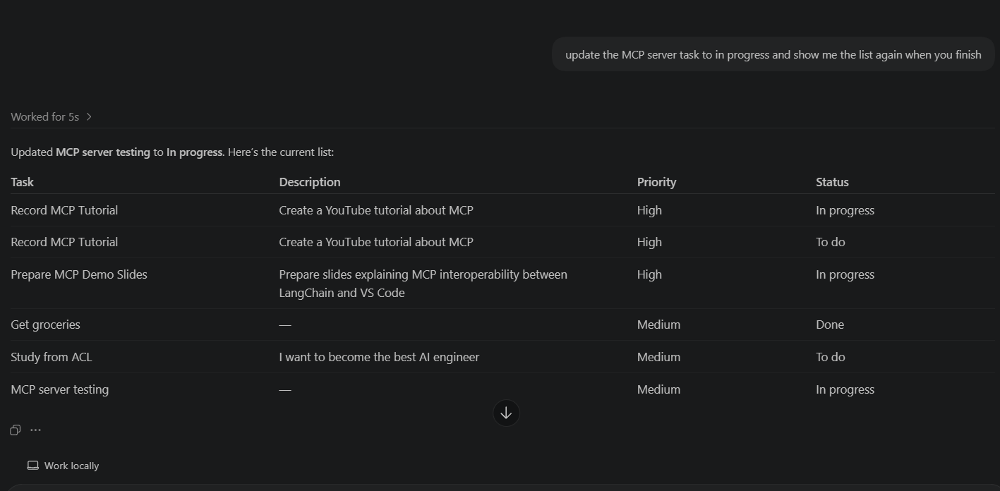
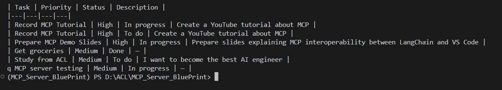
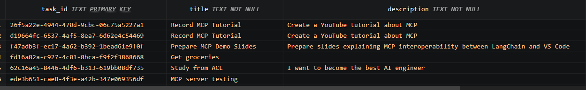

# MCP Server Blueprint

> An end-to-end learning project for building an MCP server, connecting clients, and giving an AI agent access to persistent tools.


[](LICENSE)

This repository demonstrates a practical MCP pattern: expose ordinary Python functions as tools, connect to them over HTTP, and persist their data in SQLite. The example is a small task manager with tools to create, list, and update tasks. It also includes a Python MCP client and an optional LangChain agent that can use the same server.

Use it to learn how the pieces fit together, then adapt the server and tools to your own project. This is a local learning blueprint, not a production-ready service.

## Contents

- [What you will build](#what-you-will-build)
- [Architecture](#architecture)
- [Screenshots](#screenshots)
- [Available tools](#available-tools)
- [Quick start](#quick-start)
- [Connect a client](#connect-a-client)
- [Use with Codex](#use-with-codex)
- [Optional: use the LangChain agent](#optional-use-the-langchain-agent)
- [Project structure](#project-structure)
- [Extend the blueprint](#extend-the-blueprint)
- [Practical notes](#practical-notes)
- [Troubleshooting](#troubleshooting)
- [Further reading](#further-reading)
- [License](#license)

## What you will build

- An HTTP MCP server built with [FastMCP](https://gofastmcp.com/).
- Three discoverable tools for managing tasks.
- A SQLite database that keeps tasks between server restarts.
- A Python client that discovers and calls MCP tools.
- An optional LangChain agent that receives the server's tools and can call them in response to a prompt.

## Architecture



The server runs at `http://127.0.0.1:8000/mcp`. Both the bundled Python client and the optional LangChain agent connect to this endpoint. The server reads and writes tasks in `data/tasks.db`.

## Screenshots

These examples show the same task server being used through different clients and backed by the SQLite database.

### Codex using the MCP tools



Codex updates a task's status, then calls the server again to display the updated list.

### LangChain client output



The LangChain integration reads and updates tasks through the same MCP endpoint.

### SQLite persistence



The task records are persisted in `data/tasks.db`, so they remain available after the server stops.

## Available tools

| Tool | Inputs | Behavior |
|---|---|---|
| `create_task` | `title` (required), `priority` (defaults to `medium`), `description` (defaults to an empty string) | Creates a task with a UUID and the initial status `todo`, then saves it to SQLite. |
| `list_tasks` | None | Returns all tasks currently stored in the database. |
| `update_task_status` | `task_id`, `status` (`todo`, `in_progress`, or `done`) | Updates the matching task and returns it. If the ID does not exist, returns an error object. |

The status is restricted to the three values shown above. Priority is currently an unrestricted string; the server does not validate a priority scale.

## Quick start

### Requirements

- Python 3.12 or newer
- [`uv`](https://docs.astral.sh/uv/getting-started/installation/) for the locked project environment
- An OpenAI API key only if you plan to run the optional LangChain agent

Clone the repository, open a terminal in its root directory, then install the project dependencies:

```bash
uv sync --locked
```

Initialize the SQLite schema. The helper creates the data directory and table if they are missing, and is safe to run again.

```bash
uv run python -c "from mcp_server_blueprint.database import init_db; init_db()"
```

Start the MCP server:

```bash
uv run python -m mcp_server_blueprint.server
```

Keep this terminal running. The server listens on port `8000` and serves MCP at `http://127.0.0.1:8000/mcp`.

## Connect a client

Configure your MCP-compatible host to connect to `http://127.0.0.1:8000/mcp` using its HTTP transport option. Client configuration formats vary, so use the format required by your host.

The repository also includes `src/mcp_server_blueprint/client.py`, which shows how to discover tools and call them with FastMCP's Python client. For a compact example you can run yourself, save this as `try_tools.py` in the repository root while the server is running:

```python
import asyncio

from fastmcp import Client


async def main() -> None:
    async with Client("http://127.0.0.1:8000/mcp") as client:
        tools = await client.list_tools()
        print("Available tools:", [tool.name for tool in tools])

        created = await client.call_tool(
            "create_task",
            {
                "title": "Explore MCP",
                "priority": "high",
                "description": "Call a task tool through the MCP client.",
            },
        )
        task_id = created.data["task_id"]
        print("Created:", created.data)

        updated = await client.call_tool(
            "update_task_status",
            {"task_id": task_id, "status": "in_progress"},
        )
        print("Updated:", updated.data)

        tasks = await client.call_tool("list_tasks")
        print("Tasks:", tasks.data)


asyncio.run(main())
```

Run it from the project root:

```bash
uv run python try_tools.py
```

This example writes a task to `data/tasks.db`; that change remains after the server stops.

## Use with Codex

With the MCP server running, register its HTTP endpoint with the Codex CLI:

```bash
codex mcp add mcp_server_blueprint --url http://127.0.0.1:8000/mcp
```

Check that Codex has the server configured:

```bash
codex mcp list
```

Codex CLI and its IDE extension share this MCP configuration. The `127.0.0.1` address works when Codex and the MCP server run on the same machine. If you change the server port or URL, update the address registered with Codex.

Try a read-only request first:

```text
List my tasks using the MCP server. Do not create or update anything.
```

Then try a task update and ask Codex to verify it:

```text
Set "MCP server testing" to in_progress, then list the tasks to confirm the change.
```

The server exposes tools that create and update persistent task data. Codex tool calls can therefore change `data/tasks.db`; review the requested action before approving a write. The [Codex screenshot](screenshots/codex_using_mcp.png) shows an update followed by a fresh task list.

## Optional: use the LangChain agent

The LangChain integration connects to the same MCP endpoint, adapts the discovered tools for a LangChain agent, and starts an interactive terminal loop. Model calls may incur API costs, and the agent can change task data by calling the server's tools.

Create a `.env` file in the repository root with your API key:

```env
OPENAI_API_KEY=your_openai_api_key_here
```

Start the server in one terminal, then start the agent in another:

```bash
uv run python -m mcp_server_blueprint.langchain_client
```

The model name is configured in `src/mcp_server_blueprint/langchain_client.py`. Change it to a model available to your account if needed. Enter `q` in the interactive prompt to exit.

## Project structure

| Path | Purpose |
|---|---|
| `src/mcp_server_blueprint/server.py` | FastMCP server and task tool definitions |
| `src/mcp_server_blueprint/database.py` | SQLite initialization and task persistence functions |
| `src/mcp_server_blueprint/client.py` | FastMCP client examples for listing and calling tools |
| `src/mcp_server_blueprint/langchain_client.py` | Optional LangChain agent connected to the MCP server |
| `data/tasks.db` | SQLite database file, created in the project data directory |
| `.env.example` | Placeholder for the optional `OPENAI_API_KEY` setting |
| `pyproject.toml` | Project metadata, Python requirement, and dependencies |
| `uv.lock` | Resolved dependency versions used by `uv sync --locked` |

## Extend the blueprint

Try extending the project in small steps:

1. Add a function decorated with `@mcp.tool` in `server.py`.
2. Add the corresponding database operation in `database.py`.
3. Call the new tool through `client.py` or the standalone client example above.
4. Ask the LangChain agent to use it and inspect the tool calls printed by the client.

Keeping tool definitions and persistence logic in separate modules makes it easier to understand and change each part independently.

## Practical notes

- The server exposes task-changing tools and has no authentication or authorization configured. Keep it on a trusted local environment; do not expose it to an untrusted network as-is.
- The SQLite file is persistent local state. Review its contents before publishing or sharing the repository, and avoid storing private task data in a public copy.
- The database path is based on the project location, not the terminal's current working directory.
- `create_task` accepts any string for `priority`; add validation if your application needs fixed priority values.
- The console command declared in `pyproject.toml` is currently a placeholder. Use `uv run python -m mcp_server_blueprint.server` to launch the server.
- The checked-in client scripts include demonstration calls that create or update tasks. Review their inputs before running them against data you want to preserve.

## Troubleshooting

| Symptom | What to check |
|---|---|
| `no such table: tasks` | Run the database initialization command from [Quick start](#quick-start), then restart the server. |
| Connection refused | Confirm the server is running and the client uses `http://127.0.0.1:8000/mcp`. |
| The LangChain agent cannot authenticate | Confirm `.env` is in the repository root and contains a valid `OPENAI_API_KEY`. |
| The model name is unavailable | Change the configured model in `langchain_client.py` to one enabled for your API account. |

## Further reading

- [Model Context Protocol documentation](https://modelcontextprotocol.io/docs)
- [FastMCP documentation](https://gofastmcp.com/)
- [LangChain MCP integration](https://docs.langchain.com/oss/python/langchain/mcp)
- [OpenAI Docs: connect Codex to MCP servers](https://developers.openai.com/learn/docs-mcp)
- [uv documentation](https://docs.astral.sh/uv/)

## License

This project is licensed under the MIT License. You may use, modify, and redistribute it under the license terms; include the copyright and permission notice with copies or substantial portions. See [LICENSE](LICENSE).
